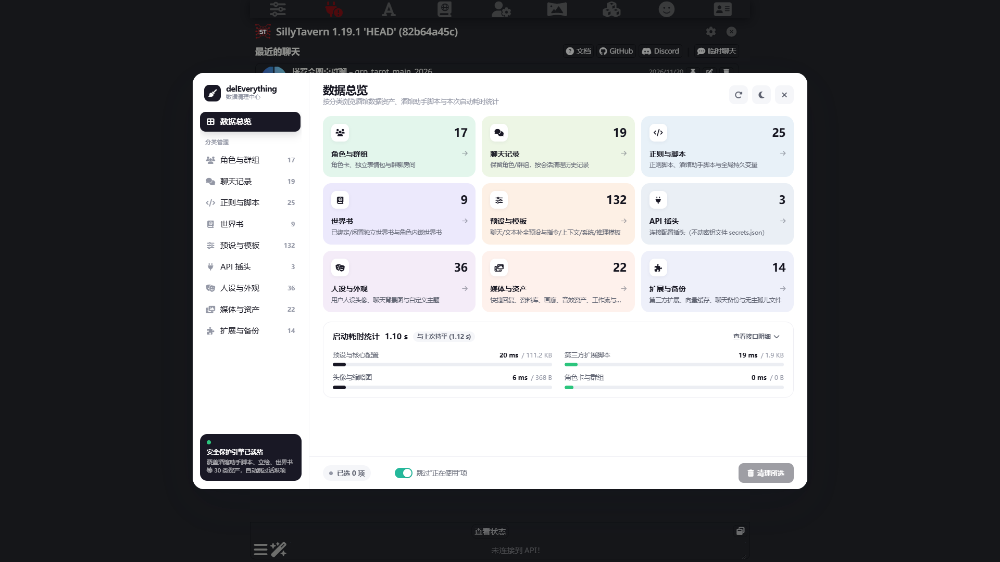
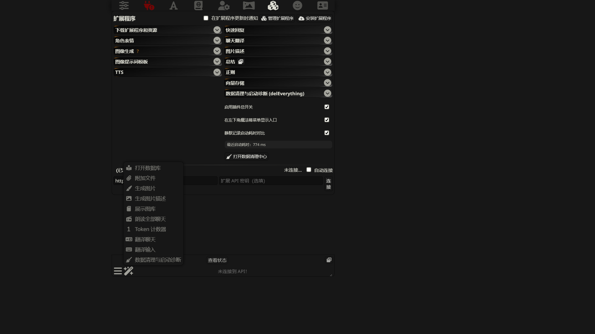

<div align="center">

# 🧹 ST-Cleaner — 数据清理与启动诊断

**专为 SillyTavern（酒馆）打造的零依赖、超轻量全量数据清理中心与冷启动耗时诊断扩展**

[](https://github.com/SillyTavern/SillyTavern)
[](#架构与性能设计)
[](#架构与性能设计)
[](#实机界面展示)
[](./LICENSE)

[核心特性](#-核心特性) • [实机界面展示](#-实机界面展示) • [快速安装](#-快速安装) • [图文使用教程](#-图文使用教程) • [支持清理矩阵](#-支持清理矩阵9-大类--30-子项) • [安全机制](#-多重防误删与安全保障) • [常见问题](#-常见问题-faq)

</div>

---

## 📖 项目简介

长期使用 SillyTavern 后，酒馆目录往往会堆积上百张测试角色卡、立绘表情包、废弃聊天分支、冗余世界书、失效正则、**酒馆助手 (`JS-Slash-Runner`) 脚本**、旧版预设模板、生图工作流以及孤儿缩略图，导致 **首屏启动变慢、列表检索困难、手机端内存吃紧**，而逐个手动删除不仅繁琐，还容易残留引用或误删共享资源。

**`ST-Cleaner`** 提供一站式解决方案：
- **平时零负担**：冷启动入口仅 **`2.2 KB`**，不引入任何第三方库；仅在点击打开面板时按需动态加载扫描与界面模块，关闭窗口即销毁 DOM 与缓存。
- **可量化的启动诊断**：静默采集浏览器 `Resource Timing` 并集墙钟耗时，直观对比 **「本次启动 vs 上次启动」** 提速幅度，定位拖慢酒馆的具体模块。
- **全分类级联安全清理**：覆盖 **9 大分类、30 种细分数据类型**（含酒馆助手全局/角色/预设脚本与文件夹嵌套树、独立立绘表情包、ST 全局持久变量、音效资产、ComfyUI 工作流等），内置汉字全拼/首字母模糊检索、定高窗口虚拟列表与 **三阶段合并写回引擎**，删得干净且绝不误伤正在使用的配置或 API 密钥。

---

## ✨ 核心特性

- ⚡ **`< 3KB` 极速冷启动**：主入口零重型静态依赖，酒馆启动阶段仅注入菜单入口并在空闲帧完成轻量采样。
- 🎨 **清爽现代 SaaS 视觉体验**：纯白画布搭配深墨色胶囊侧栏、低饱和莫兰迪色卡与松石绿方框勾选交互，同时内置一键浅色 / 深色主题切换。
- 📊 **启动耗时分段诊断**：自动合并并发请求重叠区间，按核心数据、预设模板、第三方扩展、媒体资源拆分耗时，并显示相对上次启动的提速毫秒数。
- 🗂️ **9 大分类 · 30 子项全覆盖**：除常规角色/聊天/世界书/预设/正则外，完整支持 **酒馆助手 (`TavernHelper` v3/v4) 全局脚本、角色内嵌脚本、预设内嵌脚本**、**角色立绘表情包独立清理（保留角色卡）**、**ST 全局脚本变量**、**音效/BGM/环境音资产** 与 **ComfyUI 生图工作流**。
- 🔤 **内置零依赖拼音检索引擎**：无需安装 `pinyin-pro` 等外部包，原生支持 **中文原词、全拼、首字母缩写**（如输入 `kl`、`fll`、`ttj` 秒搜对应中文条目，内置 GB2312 一级字库与古风/二游常见二级生僻字）。
- 📱 **全端自适应与万级虚拟列表**：桌面端双栏高效布局（`1366×768` 至 `2560×1440` 全档位无裁切适配），手机/Termux 端自动切换全屏抽屉与横向胶囊导航；10,000+ 条目恒定仅渲染约 25–35 个 DOM 节点。
- 🛡️ **严格防误删与引用自愈**：默认跳过全部「正在使用」项；删除角色或世界书自动清理群组、标签、人设、`charLore` 及酒馆助手脚本白名单残留绑定；**绝不触碰 `secrets.json` API 密钥文件**。

---

## 🖼️ 实机界面展示

### 1. 数据总览与启动耗时统计（莫兰迪九宫格）
纯白画布搭配左侧深色胶囊导航、九大分类低饱和色卡实时计数，以及底部简洁直观的启动耗时对比进度条：



### 2. 正则、酒馆助手脚本与全局持久变量精细清理
完整扫描全局/角色/预设正则、**酒馆助手全局/角色/预设脚本（兼容文件夹嵌套树与懒加载角色卡自动解包）** 以及 **STscript 全局脚本变量**：


### 3. 媒体、音效资产与 ComfyUI 工作流清理
一站式管理快捷回复集、资料库附件、画廊图片、BGM/环境音资产以及自定义 ComfyUI 生图工作流（自动排除内置默认工作流）：


### 4. 二次安全确认与同源合并写回提示
执行删除前自动汇总跨分类待删清单，同一角色或预设下的多条正则与酒馆助手脚本自动合并为 **1 次** 写盘请求：


### 5. 双入口集成与移动端 / Termux 响应式适配
同时提供左下角魔法棒菜单与顶部扩展折叠面板开关；手机窄屏下自动切换顶部横向胶囊导航：



<div align="center">
  
</div>

---

## 🚀 快速安装

### 方式一：通过 SillyTavern 界面一键安装（推荐）

1. 打开 SillyTavern 顶部导航栏的 **扩展 (Extensions)** 图标（积木块图标）。
2. 点击 **安装扩展 (Install extension)** 按钮。
3. 在弹出的输入框中粘贴以下仓库地址：
   ```text
   https://github.com/lazyboysjh/ST-Cleaner
   ```
4. 选择安装范围（单用户推荐默认 `Install just for me`），点击确认后刷新页面即可生效。

### 方式二：命令行手动克隆（桌面端 / Android Termux）

进入你的 SillyTavern 用户扩展目录并克隆仓库：

```bash
cd SillyTavern/data/default-user/extensions
git clone https://github.com/lazyboysjh/ST-Cleaner
```

完成后刷新浏览器页面即可。

---

## 📘 图文使用教程

### 第一步：打开清理中心与管理插件开关
安装并刷新酒馆后，你可以通过以下任意一个入口唤起面板：
- **日常快捷入口**：点击聊天输入框左下角的 **魔法棒图标 (`✨`)** → 选择 **「数据清理与启动诊断」**。
- **扩展设置入口**：点击顶部 **扩展 (`Extensions`)** → 展开 **「数据清理与启动诊断 (ST-Cleaner)」**：
  - **启用插件总开关**：取消勾选后立即卸载快捷入口并停止后台工作，无需删除插件目录。
  - **在左下角魔法棒菜单显示入口**：觉得魔法棒菜单拥挤时可单独隐藏，仅保留扩展面板内的启动按钮。
  - **静默记录启动耗时对比**：控制是否在每次刷新页面时对比启动速度变化。

### 第二步：查看启动诊断，定位拖慢酒馆的资源
打开面板后默认进入 **「总览与诊断」** 页签：
1. 顶部诊断卡片会显示本次启动的网络与静态资源墙钟总耗时；当清理数据并刷新酒馆后，右侧会自动显示绿色 **「较上次提速 xxx ms」** 徽章。
2. 点击右上角 **「接口明细」** 可展开耗时最高的 Top 接口列表；点击任意模块旁的 **「去清理」** 或下方 **九宫格分类卡片**，即可直达对应分类。

### 第三步：分类筛选与拼音模糊搜索
在 **「分类清理」** 页签中：
1. **切换子类**：点击搜索框下方的子分类胶囊（如 `世界书` 下的 `未绑定闲置世界书` / `已绑定独立世界书` / `角色卡内嵌世界书`）精准缩小范围。
2. **拼音与多词搜索**：在搜索框中直接输入中文、英文文件名、**汉语全拼** 或 **拼音首字母**，多个关键词用空格分隔（取交集）：
   - 输入 `kl` 或 `kle` → 匹配 `克莱恩·莫雷蒂`
   - 输入 `fll` → 匹配 `芙莉莲`
   - 输入 `ttj` → 匹配 `澹台烬`
3. **查看完整长文本**：遇到超长文件名或路径被省略时，点击条目右侧的 **`···`** 按钮即可弹出完整详情浮层。

### 第四步：跨分类勾选与安全批量删除
1. 支持在多个不同分类间自由切换勾选（左侧导航栏会以蓝色角标实时标记各类已选数量），也可使用 **「全选本组」** 或 **「全选结果」** 快速批处理。
2. 底部操作栏默认勾选 **「跳过 “正在使用” 项」**——即使全选了整个分类，当前激活的角色、会话、预设、世界书、API 插头、人设与主题也会被自动保护跳过。
3. 点击右下角红色 **「清理所选」** 按钮，在弹出的二次确认抽屉中核对将受影响的分类与自动解绑提示，点击 **「确认永久删除」** 即可启动三阶段高速清理，并在完成后查看成功/跳过/失败明细报告。

---

## 🗂️ 支持清理矩阵（9 大类 · 30 子项）

| 一级分类 | 包含子分类 | 清理行为与引用自愈说明 |
| :--- | :--- | :--- |
| **1. 角色与群组** | 角色卡、**角色立绘表情包 (`Sprites`)**、群聊房间 | 支持**单独清理某角色的立绘表情包而保留角色卡本体**；删除整张角色卡时自动从群组、标签、人设、`charLore` 及酒馆助手启用列表中解绑，**绝不连带删除共享世界书或预设**。 |
| **2. 聊天记录** | 角色单聊会话、群聊单条会话 | **保留角色卡与群组本体**，仅删除选中的历史会话 `.jsonl` 文件，并自动触发向量/附件关联清理事件。 |
| **3. 正则与脚本** | 全局正则、角色局部正则、预设内嵌正则、正则开关组合、**酒馆助手全局脚本**、**酒馆助手角色脚本**、**酒馆助手预设脚本**、**ST 全局脚本变量** | 完整兼容 **酒馆助手 (`JS-Slash-Runner`) v3/v4 数据结构与文件夹嵌套树**，精准剥离单条脚本而不破坏其余脚本与文件夹；支持清理 `/setglobalvar` 遗留全局持久变量；自动补全 `ST 1.19+` 懒加载 (`shallow`) 角色数据。 |
| **4. 世界书** | 未绑定闲置世界书、已绑定独立世界书、角色卡内嵌世界书 | 清晰标注全局/主世界书/辅助世界书/人设绑定去向；删除已绑定世界书自动解除各方残留引用；清空内嵌世界书仅置空 `character_book` 而不删角色卡。 |
| **5. 预设与模板** | OpenAI 聊天预设、TextGen、Instruct、Context、SysPrompt、Reasoning、NovelAI、KoboldAI | 覆盖全部 8 类生成参数预设与提示词模板，自动识别并保护当前各引擎激活项，删除预设同步清理酒馆助手预设白名单残留。 |
| **6. API 插头** | 连接配置插头 (`Connection Profiles`) | 仅清理 `extension_settings.connectionManager.profiles` 中的废弃连接配置，**100% 不读取、不修改 `secrets.json` 密钥文件**。 |
| **7. 人设与外观** | 用户人设 (`Personas`)、聊天背景图、自定义界面主题 | 兼容旧版字符串数组与新版 `{ images }` 动图背景结构；删除人设自动清理对应头像与描述绑定。 |
| **8. 媒体与资产** | 快捷回复集 (`Quick Replies`)、资料库附件 (`Data Bank`)、画廊图片、**音效与环境音资产 (`BGM/Ambient/Blip`)**、**ComfyUI 生图工作流**、角色标签 | 新增 `assets/` 音效文件清理与 `user/workflows/` 自定义 ComfyUI 工作流清理（自动排除官方内置默认工作流并保护当前选中工作流）；删除标签绝不误删角色卡本体。 |
| **9. 扩展与备份** | 第三方扩展、向量缓存 (`Vectors`)、聊天自动备份、`Data Maid` 孤儿文件 | 自动隐藏官方内置系统扩展与本插件自身；非管理员账号自动隐藏全局扩展；自动排除 `settings.json` 备份以免破坏配置回滚能力。 |

---

## 🛡️ 多重防误删与安全保障

1. **核心配置文件硬隔离**：任何操作均不会删除 `settings.json`、`secrets.json`、`config.yaml`、`default/` 官方初始种子资源、系统内置扩展及 `ST-Cleaner` 自身。
2. **「正在使用」全链路识别**：自动检测当前打开的角色/群聊、正在聊天的会话、已启用的全局/局部/预设正则、全局及当前角色绑定的世界书、各引擎当前选中预设、激活中的 API 插头、当前人设头像与当前主题。
3. **白名单与路径穿越拦截**：所有待删键值均须通过当次扫描会话白名单校验，文件名严格校验单层合法令牌与受控相对路径（如 `user/files/*`、`user/images/*`），拦截一切 `..` 越界访问。
4. **三阶段事务级批处理引擎**：
   - **Stage 1（有界并发）**：独立文件与接口删除严格限制在 `5` 路并发池内，避免瞬间打满本地 Node.js 或手机 Termux I/O；单条失败自动隔离，不中断整批任务。
   - **Stage 2（同源合并写回）**：同一角色卡删除多条局部正则 + 清空内嵌世界书，自动合并为 **1 次** `merge-attributes` 写盘；同一预设删除多条内嵌正则，自动合并为 **1 次** `presets/save` 写盘。
   - **Stage 3（内存解绑与单次落盘）**：统一同步酒馆实时 ES 模块状态（`world-info.js`、`personas.js`、`script.js`），并在末尾执行 **1 次** `saveSettings` 持久化。

---

## ✅ 真实酒馆版本兼容矩阵

本插件已在以下官方真实 SillyTavern 服务端与前端环境中通过全分类扫描、批量删除与磁盘 PNG/JSON 字节级校验：

| SillyTavern 版本 | 关键环境特征 | 实测状态 |
| :--- | :--- | :---: |
| **`v1.13.4`** | 旧版字符串数组背景列表、无聊天备份接口（自动静默降级） | ✅ 通过 |
| **`v1.17.0`** | 新版背景元数据结构、聊天备份清理、多作用域世界书解绑 | ✅ 通过 |
| **`v1.19.1`** | 开启 `performance.lazyLoadCharacters: true` 角色卡懒加载自动补全、`Reasoning` 推理模板、Secrets v2 | ✅ 通过 |

---

## ❓ 常见问题 (FAQ)

<details>
<summary><b>Q1：删除 API 连接插头会把我的 API Key 一起删掉吗？</b></summary>
<br/>
不会。SillyTavern 的 API 密钥存储在服务端受保护的 <code>secrets.json</code> 中，而「API 插头」仅清理前端连接管理器中的配置项（URL、模型名、预设关联等），本插件全程不调用任何修改或删除密钥的接口。
</details>

<details>
<summary><b>Q2：删除某张角色卡时，她绑定的独立世界书会被删掉吗？</b></summary>
<br/>
不会。独立世界书可能被多张角色卡或全局共同引用，因此删除角色卡只会删除该角色卡 PNG、专属立绘文件夹与单聊记录，并自动清理绑定关系；如需清理闲置世界书，请前往「世界书 → 未绑定闲置世界书」分类单独勾选。
</details>

<details>
<summary><b>Q3：开启了 SillyTavern 1.19+ 的角色卡懒加载（Lazy Load Characters），还能扫描出角色内嵌正则和内嵌世界书吗？</b></summary>
<br/>
完全支持。当切换到「正则脚本」或「世界书」分类时，扫描器会自动检测处于 <code>shallow === true</code> 状态的懒加载角色卡，并通过分批请求补全完整卡片数据，确保不遗漏任何局部正则或内嵌世界书。
</details>

<details>
<summary><b>Q4：安装插件本身会拖慢酒馆启动速度吗？</b></summary>
<br/>
不会。入口脚本体积不足 <code>3KB</code>，冷启动阶段不加载扫描器、删除器、拼音表与 UI 模板，仅在浏览器空闲帧读取已完成的性能条目；关闭清理窗口后所有界面节点与拼音索引缓存均立即释放回收。
</details>

---

## 📄 开源协议

本项目基于 [MIT License](./LICENSE) 开源，欢迎提交 Issue 与 Pull Request。
