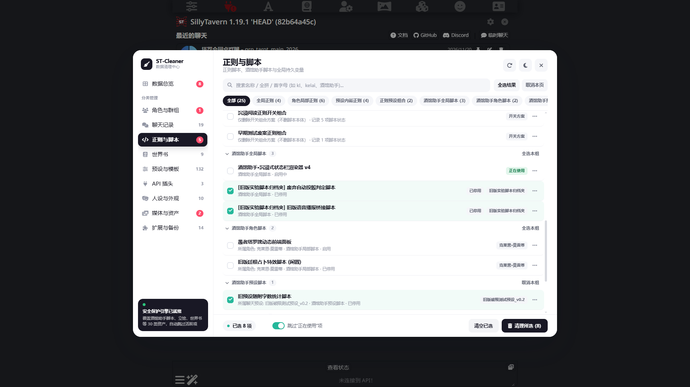
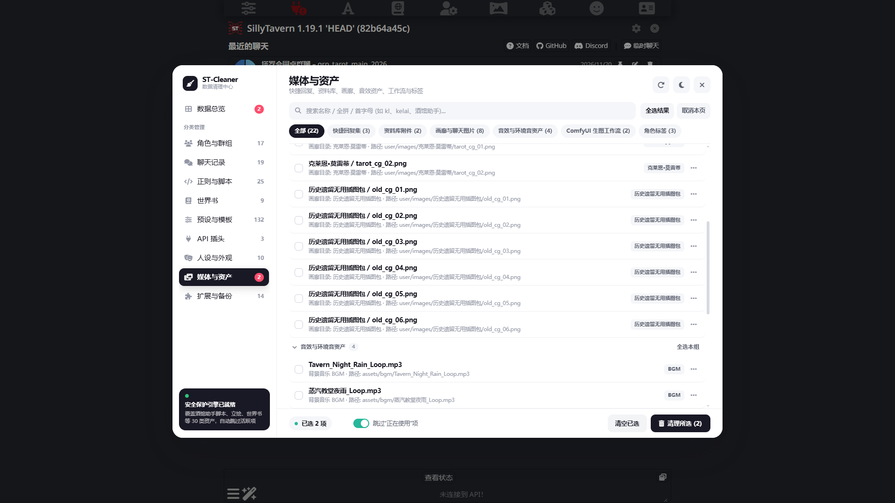
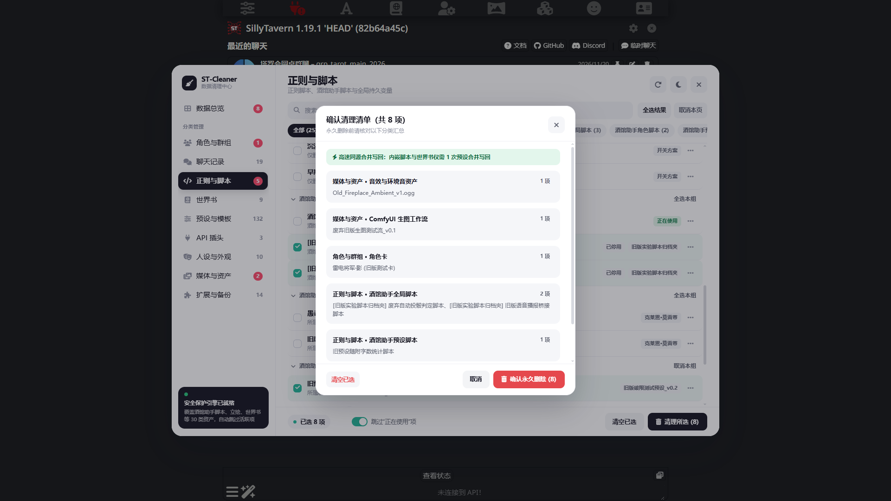
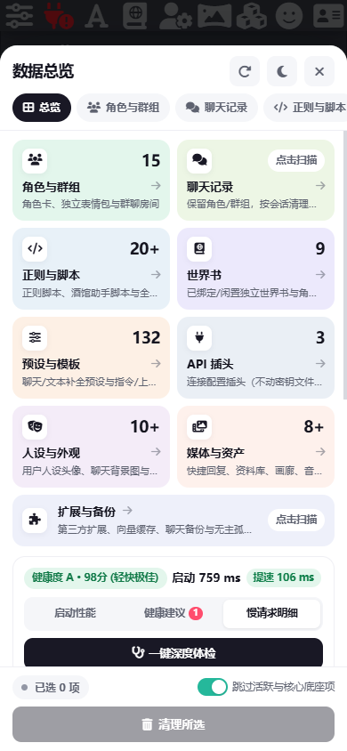
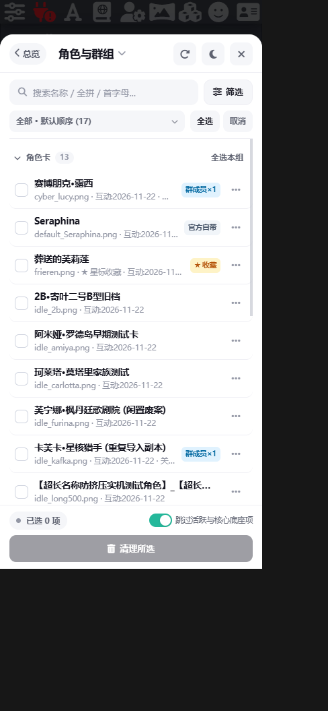

<div align="center">

# 🧹 ST-Cleaner

**SillyTavern（酒馆）全量数据清理中心与启动耗时诊断扩展**

零第三方依赖 · 冷启动仅 `2.2 KB` · 覆盖 9 大分类 30 种资产 · 默认保护正在使用项

[](https://github.com/SillyTavern/SillyTavern)
[](#-安全与高可用保障)
[](#-为什么选择-st-cleaner)
[](#-实机界面预览)
[](./LICENSE)

[核心亮点](#-为什么选择-st-cleaner) • [界面预览](#-实机界面预览) • [快速安装](#-快速安装) • [使用指南](#-四步上手指南) • [支持清理范围](#-支持清理范围9-大类--30-子项) • [安全与高可用](#-安全与高可用保障) • [常见问题](#-常见问题-faq)

</div>

---

## 💡 为什么选择 ST-Cleaner？

重度使用 SillyTavern 一段时间后，数据目录往往会不知不觉堆积上百张测试角色卡、几百兆立绘表情包、废弃聊天分支、闲置世界书、失效正则、**酒馆助手 (`JS-Slash-Runner`) 旧脚本**、过期预设以及孤儿缩略图——不仅让 **首屏启动越来越慢、找卡翻半天、手机 Termux 内存吃紧**，手动挨个删还容易遇到两个痛点：**怕删错共用世界书 / 正在用的配置**，或者 **删完文件却留下一堆失效绑定引用**。

**`ST-Cleaner`** 就是为解决这件事而生的轻量级酒馆管家：

- ⚡ **平时隐形、零启动负担**：冷启动入口仅 **`2.2 KB`**，不挂载任何第三方依赖；只有当你点开清理面板时才按需加载扫描与界面模块，关窗即彻底销毁 DOM 与内存缓存。
- 📊 **看得见的启动提速反馈**：基于浏览器原生 `Resource Timing` 静默统计并集墙钟耗时，直观对比 **「本次启动 vs 上次启动」** 提速毫秒数，一眼看清哪类资源在拖慢酒馆。
- 🗂️ **9 大分类 · 30 种资产一站式接管**：从角色卡、独立表情包、单条聊天记录、世界书、8 类生成预设，到 **酒馆助手 v3/v4 全局/角色/预设脚本**、**ST 全局脚本变量**、**BGM/音效资产** 与 **ComfyUI 工作流** 全覆盖。
- 🔤 **原生全拼与首字母秒搜**：内置轻量级汉字拼音索引（覆盖 GB2312 一级字库与古风/二游高频生僻字），输入 `kl`、`fll`、`ttj` 即可秒级定位中文条目；万级列表恒定仅渲染约 30 个节点，滚动丝滑不掉帧。
- 🛡️ **防呆保护与引用自动收尾**：默认开启 **「跳过正在使用项」**，删角色不伤共用世界书、删 API 插头绝不触碰 `secrets.json` 密钥，并在落盘阶段自动解绑群组、标签、人设与脚本白名单残留。

---

## 🖼️ 实机界面预览

### 1. 数据总览与启动耗时统计
清爽莫兰迪九宫格直观汇总全馆资产规模，下方双色进度条展示各模块启动耗时占比与提速幅度（右上角支持一键切换 **浅色 / 深色模式**）：


### 2. 正则、酒馆助手脚本与全局变量精细管理
完整识别全局/角色/预设正则、**酒馆助手 (`TavernHelper`) 全局/角色/预设脚本（兼容多层文件夹结构与 `ST 1.19+` 懒加载角色自动补全）** 及 **STscript 全局持久变量**：



### 3. 媒体、音效资产与 ComfyUI 工作流清理
集中管理快捷回复集、资料库附件、画廊插图、BGM/环境音资产与自定义 ComfyUI 生图工作流（自动隐藏官方内置默认工作流）：



### 4. 跨分类二次确认与合并写回提示
执行清理前自动生成跨分类核对清单；同一角色或预设下的多条内嵌脚本与世界书变更会自动合并为 **1 次** 写盘请求：



### 5. 双入口唤起与全端响应式适配
桌面端覆盖 `1366×768` 至 `2560×1440` 全分辨率无裁切布局；iPad 与手机 / Android Termux 窄屏自动切换顶部横向胶囊导航栏与双排操作底栏：


<div align="center">
  
  &nbsp;&nbsp;
  
</div>

---

## 🚀 快速安装

### 方式一：SillyTavern 界面内一键安装（推荐）

1. 点击 SillyTavern 顶部导航栏的 **扩展 (`Extensions`，积木图标)**。
2. 点击 **安装扩展 (`Install extension`)**。
3. 粘贴仓库地址：
   ```text
   https://github.com/lazyboysjh/ST-Cleaner
   ```
4. 点击确认安装，刷新浏览器页面即可使用。

### 方式二：命令行克隆安装（桌面端 / Android Termux）

```bash
cd SillyTavern/data/default-user/extensions
git clone https://github.com/lazyboysjh/ST-Cleaner
```

克隆完成后刷新酒馆页面即可生效。

---

## 📘 四步上手指南

1. **打开面板**
   - **快捷入口**：点击聊天输入框左下角的 **魔法棒图标 (`✨`)** → 选择 **「数据清理与启动诊断」**。
   - **扩展面板设置**：打开顶部 **扩展 (`Extensions`)** → 展开 **「数据清理与启动诊断 (ST-Cleaner)」**，可随时开关插件总状态、单独隐藏魔法棒入口，或控制后台启动耗时采样。
2. **先看总览与耗时**
   - 首页九宫格会显示各类数据总量；底部 **「启动耗时统计」** 展示首屏网络与资源墙钟耗时，点击右侧 **「查看接口明细」** 可展开最慢的接口列表，点击任意卡片直接进入对应清理页。
3. **子类筛选 + 拼音快搜**
   - 通过顶部分组胶囊（如 `未绑定闲置世界书`、`角色立绘表情包`、`酒馆助手角色脚本`）快速缩小范围。
   - 搜索框支持 **中文、英文文件名、全拼与拼音首字母**，多关键词以空格分隔取交集（如输入 `kl` 匹配 `克莱恩·莫雷蒂`，`fll` 匹配 `芙莉莲`）；超长名称可点击行尾 **`···`** 查看完整内容。
4. **跨类勾选与安全清理**
   - 可在不同分类间自由切换勾选（左侧导航栏会以珊瑚红角标实时统计各类待删项），底部默认开启 **「跳过正在使用项」**。
   - 点击右下角 **「清理所选」** 核对确认清单，确认后自动执行 **并发文件清理 → 同源合并写回 → 引用解绑落盘** 三步流水线，并展示成功 / 跳过 / 失败明细报告。

---

## 🗂️ 支持清理范围（9 大类 · 30 子项）

| 分类 | 覆盖子项 | 清理逻辑与防误伤设计 |
| :--- | :--- | :--- |
| **1. 角色与群组** | 角色卡、**角色立绘表情包 (`Sprites`)**、群聊房间 | 支持 **仅清理立绘表情包而完整保留角色卡**；删除角色卡时同步清理群组成员、标签、人设关联、`charLore` 与酒馆助手启用记录，**绝不连带删除共用世界书或预设**。 |
| **2. 聊天记录** | 角色单聊会话、群聊单条会话 | **保留角色卡与群组本体**，仅删除选中的历史聊天 `.jsonl` 文件，并触发向量与会话附件联动清理。 |
| **3. 正则与脚本** | 全局正则、角色局部正则、预设内嵌正则、正则开关组合、**酒馆助手全局/角色/预设脚本**、**ST 全局脚本变量** | 完整兼容 **酒馆助手 (`JS-Slash-Runner`) v3 / v4 脚本树与文件夹数组/字典结构**，精准移除选中脚本而不破坏同目录其他脚本；支持清理 `/setglobalvar` 遗留全局变量。 |
| **4. 世界书** | 未绑定闲置世界书、已绑定独立世界书、角色内嵌世界书 | 自动区分闲置书与绑定书并标注绑定来源；删除独立世界书自动解除全局、角色与人设引用；清理内嵌世界书仅置空 `character_book` 而不删角色卡。 |
| **5. 预设与模板** | OpenAI 聊天预设、TextGen、Instruct、Context、SysPrompt、Reasoning、NovelAI、KoboldAI | 覆盖全部 8 类参数预设与提示词模板，自动识别各引擎当前激活预设，删除时同步清理酒馆助手预设白名单残留。 |
| **6. API 插头** | 连接配置插头 (`Connection Profiles`) | 仅移除连接管理器中的废弃端点配置，**全程不读取、不修改、不触碰 `secrets.json` API 密钥文件**。 |
| **7. 人设与外观** | 用户人设 (`Personas`)、聊天背景图、自定义界面主题 | 兼容新旧版静/动态背景格式；删除人设自动清理对应头像文件与描述绑定。 |
| **8. 媒体与资产** | 快捷回复 (`Quick Replies`)、资料库附件 (`Data Bank`)、画廊图片、**音效资产 (`BGM/Ambient/Blip`)**、**ComfyUI 工作流**、角色标签 | 支持清理 `assets/` 音效文件与自定义 ComfyUI 生图工作流（自动排除内置默认工作流）；删除角色标签仅移除标签定义与绑定，绝不误删角色卡。 |
| **9. 扩展与备份** | 第三方扩展、向量缓存 (`Vectors`)、聊天自动备份、`Data Maid` 孤儿文件 | 自动隐藏官方核心扩展与 `ST-Cleaner` 自身；非管理员账号自动隐藏全局扩展；严格排除 `settings.json` 配置快照备份。 |

---

## 🛡️ 安全与高可用保障

1. **核心配置与密钥硬隔离**：任何操作均不会触碰 `secrets.json`、`settings.json` 本体、`config.yaml`、`default/` 官方种子资源、系统内置扩展及 `ST-Cleaner` 自身。
2. **会话白名单与路径防越界**：所有执行键必须命中当次扫描白名单并通过二次路径合法性校验（拦截一切 `..`、空字节、绝对路径及受保护内置资源名）。
3. **父子同选事务一致性**：同时勾选父级资产（如角色卡 / 群组 / 预设）与其内嵌子项时，自动跳过冗余子请求；若父级删除因服务端异常未成功，子项同步中止并保留勾选，杜绝假成功提示。
4. **索引对齐与活跃回退保护**：删除排在当前角色之前的闲置角色卡时，自动修正 `characterId` 偏移确保当前角色不错位；若用户主动关闭保护强制清理当前激活项，自动安全回退至默认预设/空状态并提示刷新同步。
5. **抗抖动、防挂死与有界并发**：
   - 扫描与删除请求均内置独立超时熔断，单个慢接口（如未启动的外部向量库）超时自动降级隔离，绝不卡死面板；
   - 快速连续切换分类页签时自动取消旧请求且不污染会话缓存；
   - 独立文件删除严格限制在 **`5` 路有界并发池**，角色与预设内嵌修改自动按归属合并为单次写回，并内置防重复提交互斥锁，兼顾速度与低配设备稳定性。

---

## ✅ 实测兼容版本

已在以下官方真实 SillyTavern 服务端与浏览器环境中通过全分类扫描、混合批量删除、故障注入及磁盘文件校验：

| SillyTavern 版本 | 实测环境特性 | 状态 |
| :--- | :--- | :---: |
| **`v1.13.4`** | 旧版字符串数组背景接口、无聊天备份 / Data Maid 接口（自动静默降级） | ✅ 通过 |
| **`v1.17.0`** | 新版背景结构、聊天备份清理、多作用域世界书级联解绑 | ✅ 通过 |
| **`v1.19.1+`** | 开启 `lazyLoadCharacters: true` 角色懒加载自动补全、推理模板、音效资产与 ComfyUI 工作流 | ✅ 通过 |

---

## ❓ 常见问题 (FAQ)

<details>
<summary><b>Q1：清理「API 插头」会把我的 API Key 删掉吗？</b></summary>
<br/>
不会。API Key 保存在服务端独立的 <code>secrets.json</code> 中，而「API 插头」仅管理前端连接配置项（反代地址、模型名、关联预设等）。<code>ST-Cleaner</code> 全程不调用任何修改或删除密钥的接口。
</details>

<details>
<summary><b>Q2：删除角色卡时，她绑定的独立世界书或酒馆助手全局脚本会被误删吗？</b></summary>
<br/>
不会。独立世界书和全局脚本可能被其他角色共同使用，因此删除角色卡只会移除该角色卡 PNG、专属立绘目录与单聊记录，并自动解除残留绑定；闲置的独立世界书或全局脚本需在对应分类下单独勾选才会删除。
</details>

<details>
<summary><b>Q3：只想清掉某张卡占空间的表情包立绘，不想删角色卡和聊天记录，可以吗？</b></summary>
<br/>
可以。进入「角色与群组 → 角色立绘表情包」子分类，勾选对应角色的立绘包清理即可，角色卡本体与所有聊天记录均会完整保留。
</details>

<details>
<summary><b>Q4：开启了 SillyTavern 1.19+ 的角色卡懒加载（Lazy Load Characters），会漏扫角色内嵌脚本或内嵌世界书吗？</b></summary>
<br/>
不会。切换到「正则与脚本」或「世界书」分类时，扫描器会自动识别尚未展开的 <code>shallow</code> 角色卡并分批补全卡片数据，确保角色局部正则、酒馆助手角色脚本与内嵌世界书全部准确列出。
</details>

<details>
<summary><b>Q5：长期开着这个扩展会影响酒馆日常打开和聊天的速度吗？</b></summary>
<br/>
完全不会。冷启动入口仅 <code>2.2 KB</code>，平时不加载扫描器、删除器、拼音词表与界面样式节点；关闭清理窗口后所有界面节点与临时索引缓存都会立即释放。
</details>

---

## 📄 开源协议

本项目基于 [MIT License](./LICENSE) 开源，欢迎提交 Issue 与建议。
