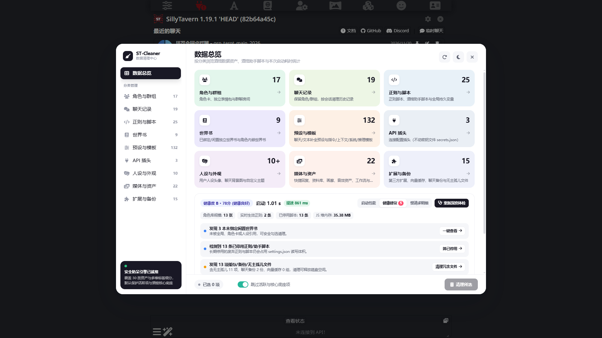

<div align="center">

# 🧹 ST-Cleaner

**SillyTavern（酒馆）全量数据清理中心与启动健康诊断扩展**

零第三方依赖 · 冷启动仅 `2.2 KB` · 覆盖 9 大分类 30 种资产 · 多维标签细分与核心底座防呆保护

[](https://github.com/SillyTavern/SillyTavern)
[](#-安全与高可用保障)
[](#-为什么选择-st-cleaner)
[](#-实机界面预览)
[](./LICENSE)

[核心亮点](#-为什么选择-st-cleaner) • [界面预览](#-实机界面预览) • [快速安装](#-快速安装) • [使用指南](#-四步上手指南) • [支持清理范围](#-支持清理范围9-大类--30-子项) • [核心底座防呆机制](#-核心底座重点标记与全删防呆保障) • [常见问题](#-常见问题-faq) • [非商用协议](#-许可协议-non-commercial-license)

</div>

---

## 💡 为什么选择 ST-Cleaner？

重度使用 SillyTavern 一段时间后，数据目录往往会堆积上百张测试角色卡、几百兆立绘表情包、短测试废档聊天、未绑定世界书、停用正则、**酒馆助手 (`JS-Slash-Runner`) 旧脚本** 以及 120+ 个混杂在一起的预设模板——不仅让 **首屏启动越来越慢、找卡翻半天、手机 Termux 内存吃紧**，手动清理更面临三大痛点：**分不清哪些是自建哪些是官方自带**、**怕误删核心底座导致酒馆报错瘫痪**、**删完文件却留下一堆失效绑定引用**。

**`ST-Cleaner`** 就是为解决这件事而生的轻量级酒馆管家：

- ⚡ **平时隐形、零启动负担**：冷启动入口仅 **`2.2 KB`**，零第三方依赖；仅在点开面板时按需动态加载扫描与界面模块，关窗即销毁 DOM 与内存索引缓存。
- 🩺 **增强版启动耗时与深度健康体检**：基于 `Navigation Timing` + `Resource Timing` 统计 `0–100` 健康度评分、首字节 `TTFB`、DOM 就绪、并发传输载荷、近 6 次启动趋势与 **Top 慢请求排行**；支持 **「一键深度体检」** 自动揪出闲置世界书、停用脚本、≤2 条测试废档会话与孤儿冗余，一键直达对应清理视图。
- 🏷️ **多维二级分类胶囊 (`Facet Bar`) + 7 种高性能排序**：支持按 **角色 `#标签`、`★ 星标收藏`、闲置状态、世界书五重绑定域、用户自建 vs 酒馆官方自带、画廊子文件夹** 秒级细分过滤；内置 **默认 / 闲置可删优先 / 名称自然序 `A↔Z` / 时间最新或最早 / 体量条数优先** 7 种排序，万级列表恒定仅渲染约 30 个虚拟节点，重排耗时 `< 15ms`。
- 🔤 **原生全拼与首字母秒搜**：内置轻量级汉字拼音索引（覆盖 GB2312 一级字库与古风/二游高频字），输入 `kl`、`fll`、`jgzs` 即可秒级定位中文条目。
- 🛡️ **源码级核心底座防呆与引用自动收尾**：经核对酒馆 `content.log` 机制（内置初始模板删后重启**不会**自动重建），自动为兜底预设、默认人设、默认主题/快捷回复及 **酒馆助手 / 提示词模板 / 小白X** 等核心生态底座打上醒目 **`⚠️ 核心底座`** 标记并默认纳入跳过保护；落盘阶段自动解绑群组、标签、人设与脚本白名单残留。

---

## 🖼️ 实机界面预览

### 1. 数据总览、启动性能透视与一键深度健康体检
清爽莫兰迪九宫格汇总全馆资产规模，底部集成 **健康度评分（A~D 级）**、首屏阶段耗时胶囊（`TTFB / DOM / 请求载荷 / 近 6 次均值`）与 **「启动性能 / 健康建议 / 慢请求明细」** 三页签诊断台（右上角支持一键切换 **浅色 / 深色模式**）：


点击 **「一键深度体检」** 后自动扫描全馆冗余，生成可一键直达对应细分筛选视图的智能清理处方：



### 2. 多维二级分类胶囊 (`Facet Bar`) 与 7 种列表排序
在角色、世界书、会话、预设等分类中自动提取 **`#角色标签`、`★ 星标收藏`、`闲置无群聊`、`官方初始角色`** 等二级胶囊，配合搜索栏右侧 **7 种排序下拉框** 秒筛闲置旧档：


### 3. 核心底座重点标记 (`⚠️ 核心底座`) 与官方自带分离
面对 130+ 个预设模板，一键点击 **「用户自建预设」** 即可筛除 120+ 个官方模板；所有删空会导致面板报错或无法回退的关键底座均以 **左侧绯红警示条 + `⚠️ 核心底座` 徽章** 醒目标注并默认锁定保护：


### 4. 正则、酒馆助手脚本与媒体生图工作流精细管理
完整识别全局/角色/预设正则、**酒馆助手 (`TavernHelper`) 多层文件夹脚本**、**STscript 全局变量**、快捷回复集、画廊子文件夹、音效资产与自定义 ComfyUI 工作流：


### 5. 二次安全确认抽屉与核心底座高危阻断预警
执行清理前自动生成跨分类核对清单；若用户主动关闭底部保护开关并勾选了 `⚠️ 核心底座` 项目，确认弹窗顶部将弹出 **高危红色预警框** 逐条列出风险原因与 `content.log` 不可自动恢复提示：


### 6. 双入口唤起与全端多分辨率自适应
通过 `1366×768`、`1600×900`、`1920×1080`、`2560×1440` 桌面四档及平板 `820×1180`、手机 / Android Termux `390×844` 全分辨率实机验收，无主操作或滚动条裁切：


<div align="center">
  
  &nbsp;&nbsp;
  
</div>

---

## 🚀 快速安装

### 方式一：SillyTavern 界面内一键安装（推荐）

1. 点击 SillyTavern 顶部导航栏的 **扩展 (`Extensions`，积木图标)**。
2. 点击 **安装扩展 (`Install extension`)**。
3. 粘贴仓库地址：
   ```text
   https://github.com/lazyboysjh/ST-Cleaner
   ```
4. 点击确认安装，刷新浏览器页面即可使用。

### 方式二：命令行克隆安装（桌面端 / Android Termux）

```bash
cd SillyTavern/data/default-user/extensions
git clone https://github.com/lazyboysjh/ST-Cleaner
```

克隆完成后刷新酒馆页面即可生效。

---

## 📘 四步上手指南

1. **打开面板**
   - **快捷入口**：点击聊天输入框左下角的 **魔法棒图标 (`✨`)** → 选择 **「数据清理与启动诊断」**。
   - **扩展面板设置**：打开顶部 **扩展 (`Extensions`)** → 展开 **「数据清理与启动诊断 (ST-Cleaner)」**，可随时开关插件总状态、单独隐藏魔法棒入口，或控制后台启动耗时采样。
2. **总览体检与慢请求排查**
   - 首页底部诊断中心默认展示本次启动墙钟耗时、阶段拆解与提速幅度；可切换查看 **「慢请求明细」** 定位拖慢启动的大体积资源，或点击 **「一键深度体检」** 获取全馆冗余清理建议并一键直达。
3. **二级细分胶囊 + 7 种排序 + 拼音快搜**
   - 先选一级分组胶囊（如 `角色卡`、`独立世界书`、`聊天补全`），再用下方 **「细分」胶囊栏** 按 `#标签`、`用户自建`、`闲置可删`、`≤2条测试废档` 等维度精准聚焦。
   - 右侧排序框支持一键切换 **`闲置可删优先`、`名称 A→Z / Z→A`、`时间最新 / 最早旧档`、`体量 / 条数优先`**；搜索框支持中文、英文文件名、全拼与拼音首字母多词交集检索。
4. **跨类勾选与安全清理**
   - 可在不同分类间自由切换勾选（左侧导航栏以珊瑚红角标实时统计待删项），底部默认开启 **「跳过活跃与核心底座项」**。
   - 点击右下角 **「清理所选」** 核对确认清单，确认后自动执行 **有界并发文件清理 → 同源合并写回 → 引用解绑落盘** 三步流水线，并展示成功 / 跳过 / 失败明细报告。

---

## 🗂️ 支持清理范围（9 大类 · 30 子项）

| 分类 | 覆盖子项 | 二级细分维度与防误伤设计 |
| :--- | :--- | :--- |
| **1. 角色与群组** | 角色卡、**角色立绘表情包 (`Sprites`)**、群聊房间 | 细分：`闲置无群聊/非收藏`、`★ 星标收藏`、`群聊成员`、`官方初始角色`、动态 `#角色标签`、`未打标签`。支持仅删立绘保留角色卡；删卡同步解绑群组/标签/人设/`charLore`/助手记录，**绝不连带删除共用世界书或预设**。 |
| **2. 聊天记录** | 角色单聊会话、群聊单条会话 | 细分：`历史旧分支`、`极短测试档 (≤2条)`、`各角色当前主会话`、继承 `#角色标签`。保留角色与群组本体，仅删除选中 `.jsonl` 并联动清理向量与会话附件。 |
| **3. 正则与脚本** | 全局/角色/预设正则、正则开关组合、**酒馆助手全局/角色/预设脚本**、**ST 全局脚本变量** | 细分：`已停用闲置`、`启用中`、`原生正则`、`酒馆助手脚本`、`文件夹归档脚本`、`变量与开关组合`。完整兼容酒馆助手 v3/v4 脚本树与文件夹结构。 |
| **4. 世界书** | 未绑定闲置世界书、已绑定独立世界书、角色内嵌世界书 | 细分：`未绑定闲置`、`全局常驻启用`、`角色主世界书`、`角色辅助书`、`人设/会话绑定`、`角色卡内嵌`、`用户自建 / 官方自带`、继承 `#角色标签`。删除独立书自动解除多域引用；清理内嵌书仅置空 `character_book`。 |
| **5. 预设与模板** | OpenAI、TextGen、Instruct、Context、SysPrompt、Reasoning、NovelAI、KoboldAI | 细分：`用户自建预设`、`酒馆官方自带`、`⚠️ 核心兜底底座`。一键分离自建预设与上百个官方自带模板，保护各引擎兜底底座。 |
| **6. API 插头** | 连接配置插头 (`Connection Profiles`) | 标注 `⚠️ 含连接地址` 提醒（移除反代地址与模型绑定，但 **全程绝不读取或触碰 `secrets.json` API 密钥文件**）。 |
| **7. 人设与外观** | 用户人设 (`Personas`)、聊天背景图、自定义界面主题 | 细分：`用户自建/上传`、`酒馆官方自带`、`动态视频背景`、`⚠️ 核心兜底底座`。硬性排除 `__transparent.png` 透明兜底背景，默认保护 `user-default.png` 与 `Dark Lite` 主题。 |
| **8. 媒体与资产** | 快捷回复 (`Quick Replies`)、资料库附件 (`Data Bank`)、画廊图片、**音效资产**、**ComfyUI 工作流**、角色标签 | 细分：`用户资源`、`⚠️ 核心兜底底座`、`空置无角色标签`、动态 `📁 画廊子文件夹`。保护 `Default` 默认快捷回复底座，自动隐藏内置默认生图工作流。 |
| **9. 扩展与备份** | 第三方扩展、向量缓存 (`Vectors`)、聊天自动备份、`Data Maid` 孤儿文件 | 细分：`第三方扩展`、`已禁用扩展`、`⚠️ 核心生态底座`、`缓存/备份/孤儿文件`。默认保护酒馆助手/提示词模板/小白X/记忆书等核心运行时底座，严格排除 `settings.json` 快照。 |

---

## 🛡️ 核心底座重点标记与全删防呆保障

针对「**如果把列表里的东西全选全删了，酒馆还能不能正常工作？**」这一核心安全问题，`ST-Cleaner` 结合 SillyTavern 服务端源码（`seedContent` 与 `content.log` 首次释放记录机制——**官方初始资产一旦删除，重启酒馆不会自动重新生成**）建立了四层防线：

1. **系统硬性兜底资产永久隐藏与拦截**：
   - 官方核心内置扩展、`ST-Cleaner` 自身、`secrets.json` 密钥、`settings.json` 本体、内置默认 ComfyUI 工作流，以及前端写死回退引用的透明背景 **`__transparent.png`** 均在扫描层隐藏并在删除执行层二次硬拦截，任何情况下不可删除。
2. **`⚠️ 核心底座` 重点视觉标记与默认锁定保护**：
   - 以下删空会导致酒馆前端报错、无默认回退或大量角色卡失效的项目，均带有 **左侧绯红边框 + `⚠️ 核心底座` 徽章**，并在默认开启 **「跳过活跃与核心底座项」** 时即使点击「全选」也会自动跳过：
     - **生成引擎兜底预设**：`openai` / `textgenerationwebui` / `context` 的 `Default` 预设、`sysprompt` / `reasoning` 的 `Blank`（或 `Default`）模板，以及 `openai` 下仅剩的最后 1 个预设（删成 0 个会导致 `openai.js` 抛异常）；
     - **默认外观与交互底座**：默认用户人设头像 `user-default.png`、基础回退主题 `Dark Lite`、默认快捷回复集 `Default`；
     - **核心酒馆生态扩展底座**：`JS-Slash-Runner`（酒馆助手 `TavernHelper`）、`ST-Prompt-Template`（提示词模板）、`LittleWhiteBox`（小白X）、`MemoryBooks`（记忆书）——即使当前暂时停用也默认予以底座保护，防止误删引发角色卡前端界面与脚本大面积瘫痪。
3. **关闭保护强删时的高危二次阻断预警**：
   - 仅当用户主动关闭底部保护开关并勾选了 `⚠️ 核心底座` 项时才允许进入确认页，且确认抽屉顶部会醒目弹出 **高危红色预警卡** 逐项告知后果。
4. **父子同选事务一致性与有界并发**：
   - 独立文件删除严格限制在 **`5` 路有界并发池**，角色与预设内嵌子项修改自动合并为 **单次** 写盘请求，并内置超时熔断、请求取消与 `characterId` 偏移自动修正。

---

## ✅ 实测兼容版本

已在以下官方真实 SillyTavern 服务端与浏览器环境中通过全分类扫描、全选防呆测试、混合批量删除、故障注入及磁盘文件校验：

| SillyTavern 版本 | 实测环境特性 | 状态 |
| :--- | :--- | :---: |
| **`v1.13.4`** | 旧版字符串数组背景接口、无聊天备份 / Data Maid 接口（自动静默降级） | ✅ 通过 |
| **`v1.17.0`** | 新版背景结构、聊天备份清理、多作用域世界书级联解绑 | ✅ 通过 |
| **`v1.19.1+`** | 开启 `lazyLoadCharacters: true` 角色懒加载自动补全、推理模板、音效资产与 ComfyUI 工作流 | ✅ 通过 |

---

## ❓ 常见问题 (FAQ)

<details>
<summary><b>Q1：开启默认保护时，在各个分类里直接点「全选结果」清理安全吗？</b></summary>
<br/>
安全。底部默认开启 <b>「跳过活跃与核心底座项」</b>，即使直接点击「全选结果」，所有正在使用的角色/世界书/预设/背景，以及标有 <code>⚠️ 核心底座</code> 的兜底预设、默认人设、默认主题和核心生态扩展（如酒馆助手）都会在预览与执行两道关卡被自动跳过，不会导致酒馆报错或无法使用。注意：闲置的角色卡、聊天记录或自建预设一旦删除不可恢复，全选前仍建议通过「细分胶囊」核对范围。
</details>

<details>
<summary><b>Q2：清理「API 插头」会把我的 API Key 删掉吗？</b></summary>
<br/>
不会。API Key 保存在服务端独立的 <code>secrets.json</code> 中，而「API 插头」仅管理前端连接配置项（反代 URL 地址、模型名、关联预设等，列表中标有 <code>⚠️ 含连接地址</code> 提醒）。<code>ST-Cleaner</code> 全程不调用任何修改或删除密钥的接口。
</details>

<details>
<summary><b>Q3：酒馆官方自带的 120 多个预设模板或默认角色删掉后，重启酒馆会自动恢复吗？</b></summary>
<br/>
<b>不会自动恢复。</b>SillyTavern 会在数据目录的 <code>content.log</code> 中记录首次释放过的内置文件名，重启时不会二次释放已记录过的文件。因此 <code>ST-Cleaner</code> 专门区分了 <code>用户自建</code> 与 <code>官方自带</code> 徽章，并将关键兜底模板标为 <code>⚠️ 核心底座</code> 默认保护。
</details>

<details>
<summary><b>Q4：只想清掉某张卡占空间的表情包立绘，或者只清 ≤2 条消息的测试废档聊天，可以吗？</b></summary>
<br/>
可以。清理立绘请进入「角色与群组 → 角色立绘表情包」勾选对应立绘包；清理废档会话请进入「聊天记录」并点击细分胶囊栏中的 <b>「极短测试档 (≤2条)」</b> 一键筛选清理，角色卡本体与其他正常聊天记录均完整保留。
</details>

<details>
<summary><b>Q5：开启了 SillyTavern 1.19+ 的角色卡懒加载（Lazy Load Characters），会漏扫内嵌脚本或内嵌世界书吗？</b></summary>
<br/>
不会。切换到「正则与脚本」或「世界书」分类（或执行「一键深度体检」）时，扫描器会自动识别尚未展开的 <code>shallow</code> 角色卡并分批补全卡片数据，确保角色局部正则、酒馆助手角色脚本与内嵌世界书全部准确列出。
</details>

---

## 📄 许可协议 (Non-Commercial License)

本项目采用 **[ST-Cleaner 非商业使用许可协议 (Non-Commercial License)](./LICENSE)** 发布，版权归 **[@lazyboysjh](https://github.com/lazyboysjh)** 所有：

- ✅ **允许个人免费使用与学习**：个人用户可免费下载、安装、自用修改及在保留完整署名与本协议的前提下非商业分享。
- 🚫 **严禁任何形式的商业用途**：未经作者事前书面授权，**严禁出售本插件或其衍生版本、严禁打包进任何收费整合包 / 付费懒人包、严禁用于付费社群 / 赞助门槛解锁或商业云酒馆 / SaaS 托管服务**。详见 [`LICENSE`](./LICENSE)。
